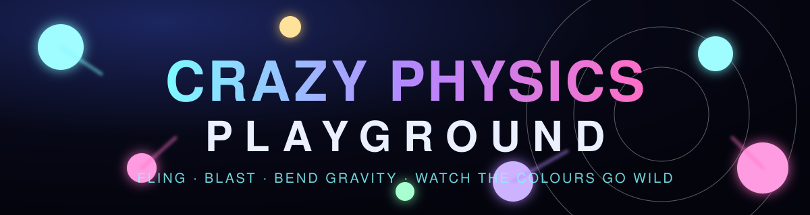

<p align="center"></p>

<p align="center">
  
  
  
  
</p>

# 🌀 Crazy Physics Playground

A neon sandbox where hundreds of glowing balls collide, orbit gravity wells, get blasted across the screen and change colour on every hit. Pure TypeScript and Canvas 2D, with **zero runtime dependencies**.

## ✨ Features

- 🎱 **Up to 600 balls** with mass-aware collisions, so heavy balls shove light ones around
- ⚡ **Spatial-hash collision detection**, roughly O(n) instead of O(n²)
- ⏱️ **Fixed 120 Hz physics step**, so it behaves the same at 60, 120 or 144 fps
- 🕳️ **Gravity wells**: attracting (cyan) or repelling (pink), fading over time
- 💥 **Blast** with a shockwave ring and distance falloff
- 🎨 **Three colour modes**: Flow (hues drift and shift on impact), Speed (blue → red), Size
- 🖐️ **Mouse, touch and pen** support through pointer events
- 🪄 Motion trails, pause, live FPS counter and a collapsible control panel

## 🚀 Quick start

**Fastest:** open `preview.html` in any modern browser. It is a single self-contained file.

**Full project:**

```bash
npm install        # installs TypeScript
npm run build      # compiles main.ts -> main.js
npm run serve      # serves the folder on http://localhost:8080
```

> `index.html` loads `main.js` as an ES module, so serve it over HTTP instead of double-clicking it (`npm run serve` does this).

## 🎮 Controls

| Input | Action |
|---|---|
| **Drag** | Spawn balls and attract them |
| **Right-click drag** / **Shift + drag** | Repel |
| **Double-click** or **W** | Drop a gravity well at the cursor |
| **Shift + double-click** / **Shift + W** | Drop a repelling well |
| **Space** | Blast from the cursor |
| **B** | Burst of 40 balls at the cursor |
| **C** | Cycle colour mode |
| **T** | Toggle trails |
| **P** | Pause / resume |
| **R** | Reset |

Sliders: **Gravity** (negative floats upward), **Bounce** (above 1.0 adds energy on wall hits), **Chaos** (wobbly wind, and the strength of pulls, wells and blasts).

## 🗂️ Project layout

```
index.html     page + control panel
style.css      neon UI styling
main.ts        source (edit this)
main.js        compiled output (generated by `npm run build`)
preview.html   everything inlined into one file
banner.svg     README banner
tsconfig.json  strict TypeScript config
package.json   build / watch / serve scripts
```

## 🧠 How it works

1. **Verlet integration**: velocity is implied by `position − previousPosition`, which keeps collisions stable.
2. **Fixed timestep with accumulator**: rendering is decoupled from physics, and slow frames are dropped rather than spiralling.
3. **Spatial hash grid**: balls are bucketed into 48 px cells and only neighbouring cells are tested.
4. **Impulse collisions**: separation and bounce are weighted by mass (`m = r²`) with restitution tied to the Bounce slider.
5. **Rendering**: translucent fills for trails plus additive blending (`lighter`) for the glow.

## 🔧 Hack it

Tweak the constants at the top of `main.ts`:

| Constant | Effect |
|---|---|
| `MAX_BALLS` | Ball cap (try 1000 on a fast machine) |
| `STEP` | Physics step; smaller is more accurate and costs more CPU |
| `MAX_V` | Speed limit per step |
| `CELL` | Grid cell size; keep it at least the largest ball diameter |
| `WELL_LIFE` | How long gravity wells last |

Run `npm run watch` to recompile on save.

## 💡 Ideas to extend

Obstacles and bumpers · springs and ropes · black holes that swallow balls · save/share scenes · GIF recording · slow-motion

---

<p align="center">Made for fun. Break the physics. 🌌</p>
