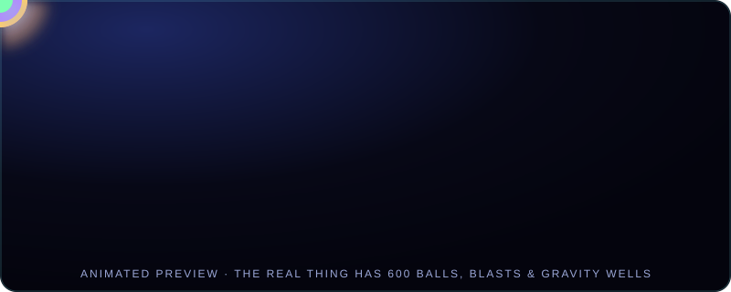

<p align="center"></p>

<p align="center">
  
  
  
  
  
</p>

# 🌀 Crazy Physics Playground

A neon sandbox where hundreds of glowing balls collide, orbit gravity wells, get blasted across the screen, and shift colour on impact. Built with strict TypeScript and Canvas 2D, with no runtime dependencies.

<p align="center"></p>

## Visual demo

<video src="visual-demo.mp4" controls playsinline preload="metadata" width="720">
  Your browser cannot play the embedded video. [Open the visual demo](visual-demo.mp4).
</video>

## Features

- Up to 600 balls with mass-aware collisions
- Spatial-hash collision detection
- Fixed 120 Hz physics step
- Attracting and repelling gravity wells
- Blasts with distance falloff and shockwave rings
- Flow, Speed, and Size colour modes
- Mouse, touch, and pen input
- Motion trails, pause, live FPS counter, and collapsible controls

## Quick start

Open `preview.html` in a modern browser to play without installing anything.

To run the full project, use Node.js 18 or newer:

```bash
npm install
npm run build
npm run serve
```

Then open the local address printed by the server (usually `http://localhost:8080`). The main page loads `main.js` as an ES module, so serve it over HTTP rather than opening `index.html` directly.

## Controls

| Input | Action |
|---|---|
| Drag | Spawn balls and attract them |
| Right-click drag or Shift + drag | Repel |
| Double-click or W | Add an attracting well at the cursor |
| Shift + double-click or Shift + W | Add a repelling well |
| Space | Blast at the cursor |
| B | Burst of 40 balls at the cursor |
| C | Cycle colour mode |
| T | Toggle trails |
| P | Pause or resume |
| R | Reset |

The **Gravity** slider controls vertical gravity, **Bounce** controls wall restitution, and **Chaos** controls wind and force strength. Double-click a slider to restore its default. The Blast button fires from screen centre; Space fires from the cursor.

## Project files

- `index.html`, `style.css` — app page and controls
- `main.ts` — TypeScript source
- `main.js` — compiled module loaded by the app
- `preview.html` — self-contained version for quick play
- `banner.svg`, `demo.svg` — project banner and animated preview
- `package.json`, `tsconfig.json` — build configuration
- `LICENSE` — MIT license

## How it works

The simulation uses Verlet integration with a fixed timestep and an accumulator. A spatial hash narrows collision checks to nearby balls. Collisions separate bodies according to their mass and apply a restitution impulse. Canvas trails and additive blending create the glow effect.

## License

[MIT](LICENSE)
