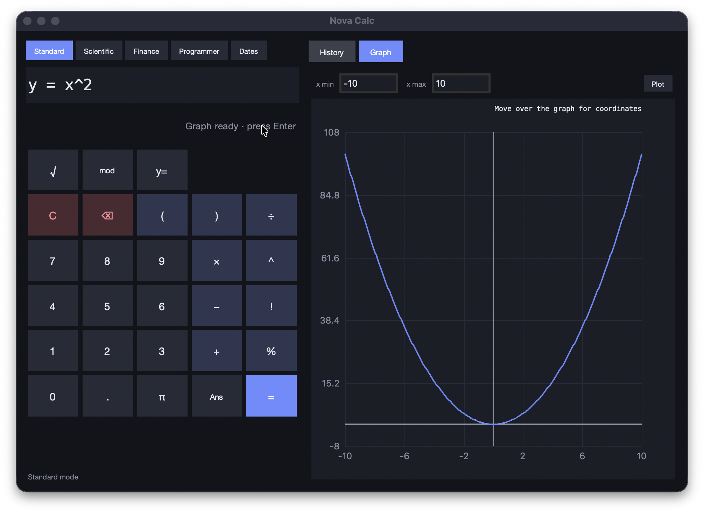
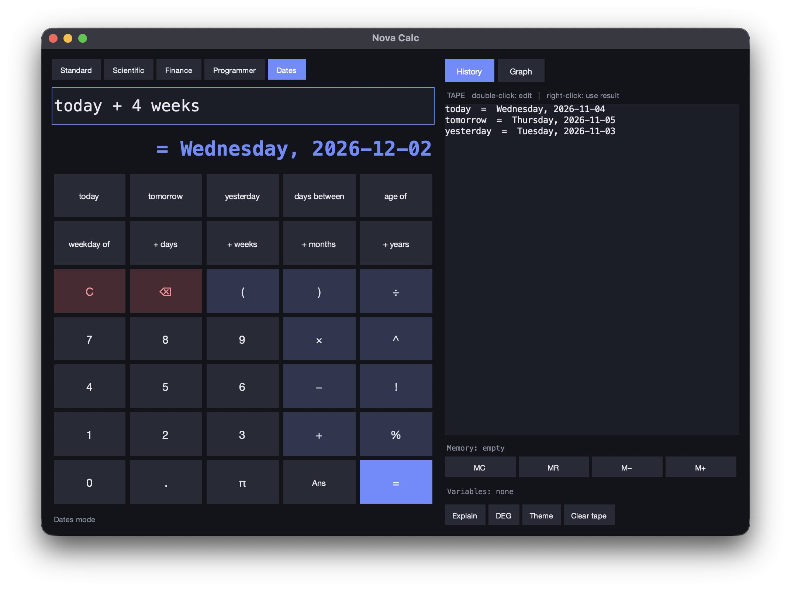
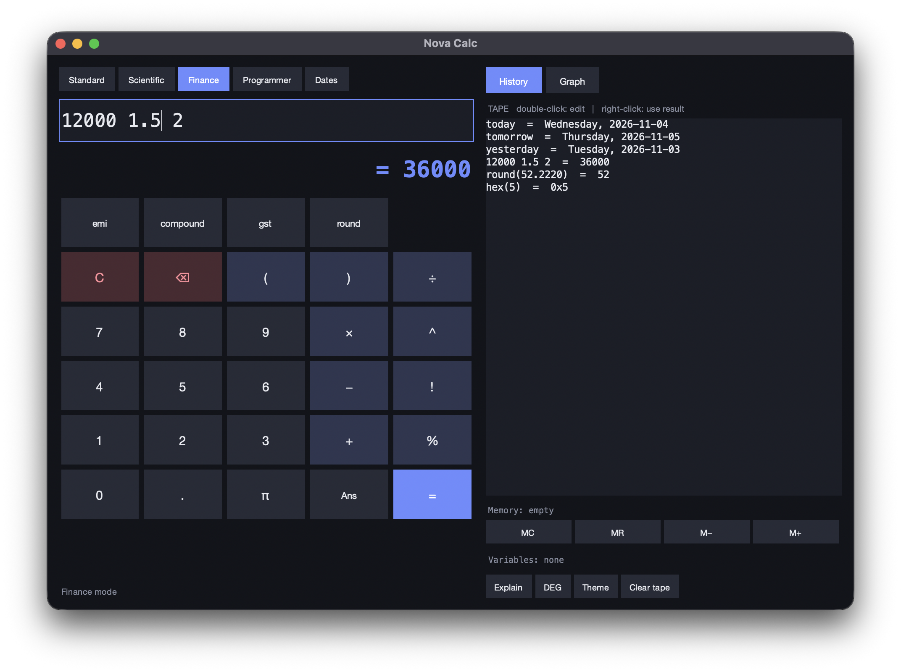

# Nova Calc

A desktop calculator with scientific expressions, variables, unit and currency
conversion, graphing, history, and plain-language date calculations.

## Screenshots

**Graph view**



**Dates mode**



**Finance mode**



## Run

```sh
python3 nova_calc.py
```

Choose **Dates** mode for date shortcuts, or type these directly into the
calculator:

| Input | Result |
| --- | --- |
| `100 usd to inr` | Converts using the latest available reference rate; uses a bundled estimate when offline. |
| `today + 30 days` | The resulting date and weekday. Also supports weeks, months, and years. |
| `days between 2026-01-01 and 2026-12-25` | `358 days` |
| `age of 1990-05-14` | Age in years, months, and days. |
| `weekday of 2026-12-25` | The weekday for that date. |

Currency rates are fetched from [Frankfurter](https://frankfurter.dev/) when
available and cached for six hours. If the network is unavailable, the
calculator falls back to its bundled approximate rates.

## Variables and Ans

Enter each line and press **Enter** to save its value. The next expression can
use named values and `ans` (the previous result):

```text
rent = 12000
tax = 18%
rent * (1 + tax)      -> 14160
ans * 12              -> 169920
```

Variables store their current values; changing `tax` affects calculations you
enter afterward, but does not rewrite earlier results in the history tape.

## More conversions and notation

Conversions use `value unit to unit`:

```text
2 m2 to ft2       -> 21.5278208334 ft2
60 kmh to mph     -> 37.2822715342 mph
8 Mb to MB        -> 1 MB
```

Area units include `mm2`, `cm2`, `m2`, `km2`, `ha`, `acre`, `ft2`, `yd2`, and
`mi2`. Speed units include `mps`, `kmh`/`kph`, `mph`, `fps`, and `knot`.
Data units include bits and bytes, decimal symbols (`kB`, `MB`, `GB`, `TB`),
and binary symbols (`KiB`, `MiB`, `GiB`, `TiB`). Data symbols are case-sensitive:
`b` means bit and `B` means byte.

Type `√16` or `√(9 + 16)` for square roots, and `5²` for `5^2`. Incomplete
expressions show hints such as “Add a value after the operator” or “Finish the
expression and close the parenthesis”.
